# Результати експерименту

Журнал: `results\main\runs.csv`  
Сформовано: 2026-11-11 00:11  

## 3.1 Характеристика масиву даних

| Прогонів | Сторінок | Сайтів | Методів | Повторів |
|---|---|---|---|---|
| 440 | 22 | 10 | 4 | 5 |

Страти за типом рендерингу:

| render_type | сторінок |
|---|---|
| hybrid | 5 |
| spa | 6 |
| ssr | 11 |

Розклад неуспішних прогонів за причинами (M11):

| method | HTTP 429 | Recall < 90 % | порожній результат | усього прогонів |
|---|---|---|---|---|
| M1 | 0 | 25 | 30 | 110 |
| M4 | 1 | 1 | 0 | 110 |

Застосовність методів (частка сторінок, де метод можна було запустити):

| index | Застосовність, % |
|---|---|
| M1 | 100 |
| M2 | 13.6 |
| M3 | 100 |
| M4 | 100 |

## 3.2 Описова статистика показників за методами

### M1 Повнота (Recall), %

| Метод | n | Медіана | Середнє | SD | IQR | Q1 | Q3 | Min | Max | CV, % | 95% ДІ медіани |
|---|---|---|---|---|---|---|---|---|---|---|---|
| M1 | 110 | 75 | 61.364 | 42.652 | 100 | 0 | 100 | 0 | 100 | 69.508 | [50.00; 100.00] |
| M2 | 15 | 100 | 100 | 0 | 0 | 100 | 100 | 100 | 100 | 0 | [100.00; 100.00] |
| M3 | 110 | 100 | 99.962 | 0.279 | 0 | 100 | 100 | 97.92 | 100 | 0.279 | [100.00; 100.00] |
| M4 | 110 | 100 | 98.314 | 12.354 | 0 | 100 | 100 | 0 | 100 | 12.566 | [100.00; 100.00] |

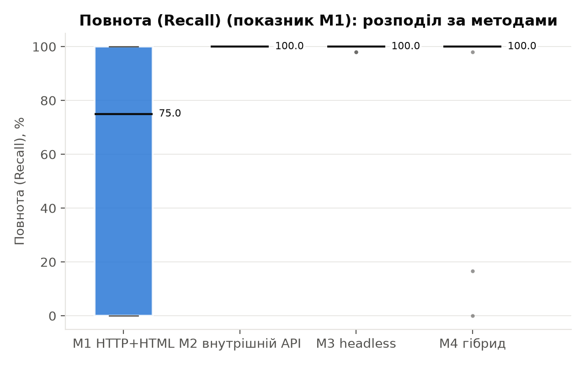

### M2 Точність вилучення (Precision), %

| Метод | n | Медіана | Середнє | SD | IQR | Q1 | Q3 | Min | Max | CV, % | 95% ДІ медіани |
|---|---|---|---|---|---|---|---|---|---|---|---|
| M1 | 110 | 100 | 72.727 | 44.74 | 100 | 0 | 100 | 0 | 100 | 61.518 | [100.00; 100.00] |
| M2 | 15 | 100 | 100 | 0 | 0 | 100 | 100 | 100 | 100 | 0 | [100.00; 100.00] |
| M3 | 110 | 100 | 99.962 | 0.279 | 0 | 100 | 100 | 97.92 | 100 | 0.279 | [100.00; 100.00] |
| M4 | 110 | 100 | 98.314 | 12.354 | 0 | 100 | 100 | 0 | 100 | 12.566 | [100.00; 100.00] |

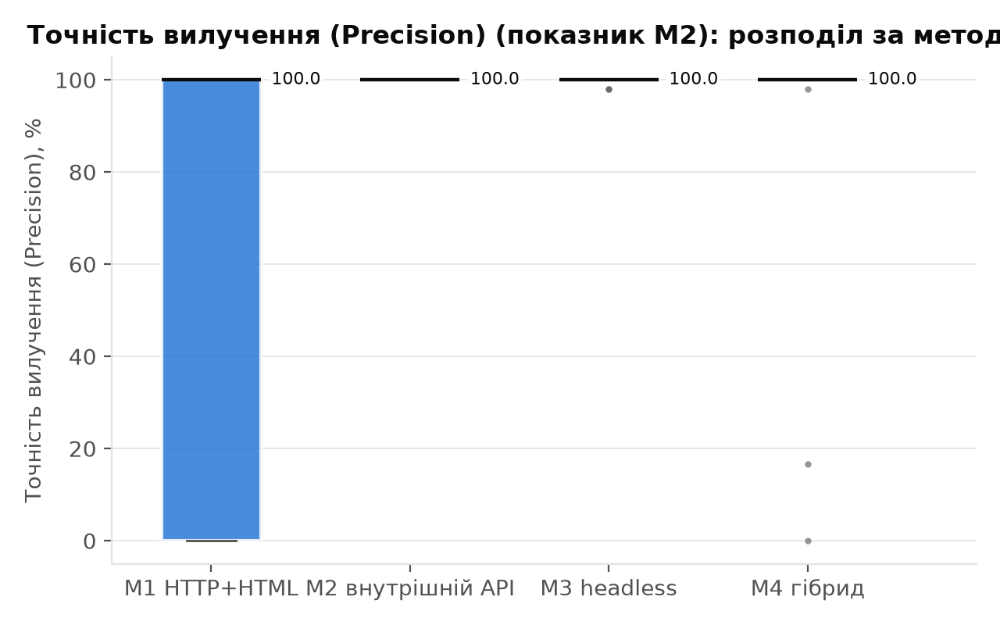

### M3 F1-міра, %

| Метод | n | Медіана | Середнє | SD | IQR | Q1 | Q3 | Min | Max | CV, % | 95% ДІ медіани |
|---|---|---|---|---|---|---|---|---|---|---|---|
| M1 | 110 | 83.335 | 65.152 | 42.209 | 100 | 0 | 100 | 0 | 100 | 64.785 | [66.67; 100.00] |
| M2 | 15 | 100 | 100 | 0 | 0 | 100 | 100 | 100 | 100 | 0 | [100.00; 100.00] |
| M3 | 110 | 100 | 99.962 | 0.279 | 0 | 100 | 100 | 97.92 | 100 | 0.279 | [100.00; 100.00] |
| M4 | 110 | 100 | 98.314 | 12.354 | 0 | 100 | 100 | 0 | 100 | 12.566 | [100.00; 100.00] |

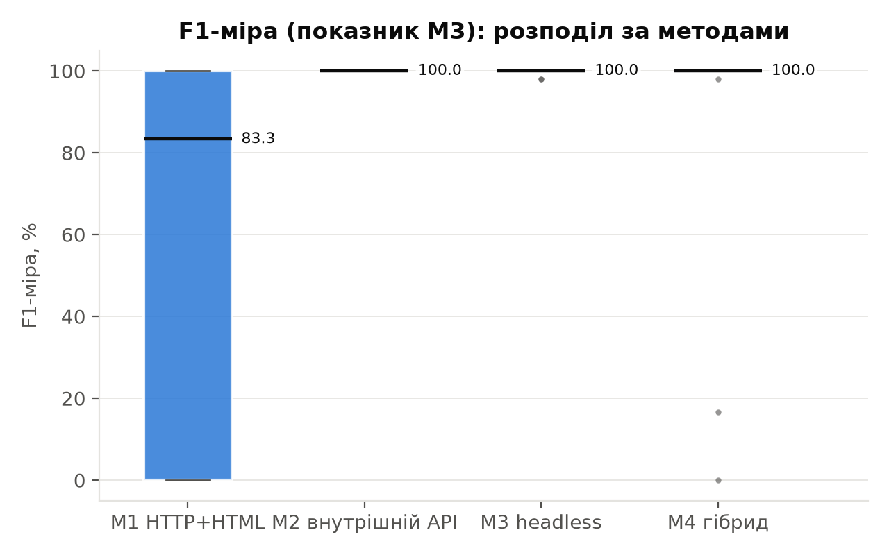

### M4 Точність поля «ціна», %

| Метод | n | Медіана | Середнє | SD | IQR | Q1 | Q3 | Min | Max | CV, % | 95% ДІ медіани |
|---|---|---|---|---|---|---|---|---|---|---|---|
| M1 | 80 | 100 | 87.162 | 33.166 | 0.52 | 99.48 | 100 | 0 | 100 | 38.051 | [100.00; 100.00] |
| M2 | 15 | 100 | 100 | 0 | 0 | 100 | 100 | 100 | 100 | 0 | [100.00; 100.00] |
| M3 | 110 | 100 | 99.62 | 1.026 | 0 | 100 | 100 | 95.83 | 100 | 1.03 | [100.00; 100.00] |
| M4 | 109 | 100 | 89.87 | 29.321 | 0 | 100 | 100 | 0 | 100 | 32.626 | [100.00; 100.00] |

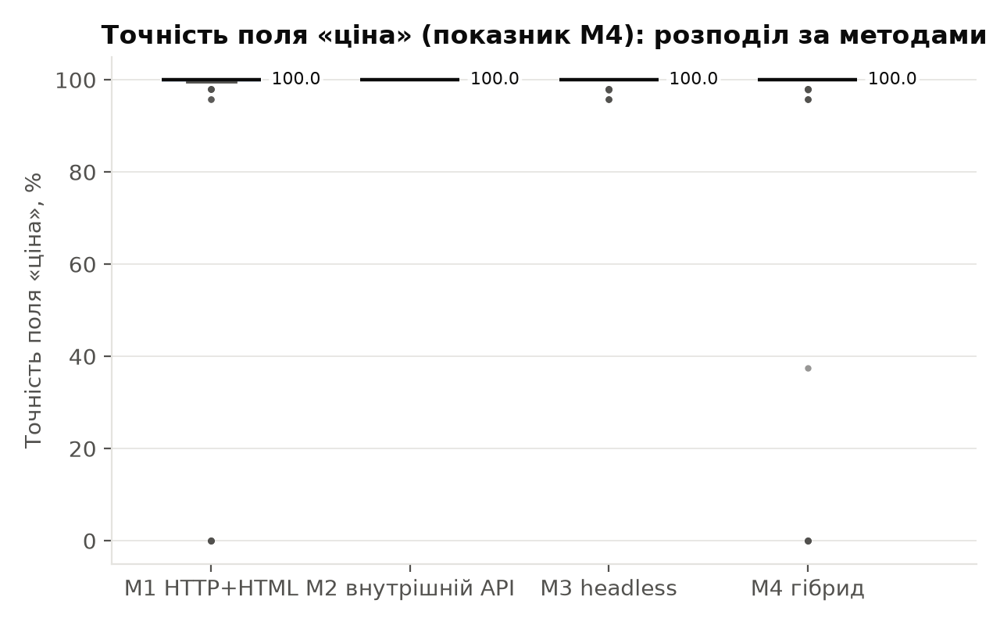

### M6 Час виконання, мс

| Метод | n | Медіана | Середнє | SD | IQR | Q1 | Q3 | Min | Max | CV, % | 95% ДІ медіани |
|---|---|---|---|---|---|---|---|---|---|---|---|
| M1 | 110 | 832.43 | 1 098.8 | 951.443 | 633.745 | 542.025 | 1 175.77 | 228.66 | 5 569.39 | 86.589 | [679.70; 966.63] |
| M2 | 15 | 281.91 | 369.271 | 163.071 | 244.935 | 233.81 | 478.745 | 225.84 | 740.4 | 44.16 | [232.97; 488.15] |
| M3 | 110 | 3 321.94 | 4 777.556 | 2 531.269 | 4 291.125 | 2 985.562 | 7 276.688 | 2 023.96 | 11 141.6 | 52.983 | [3150.34; 4356.54] |
| M4 | 110 | 3 339.74 | 3 577.934 | 2 770.955 | 3 759.575 | 1 037.412 | 4 796.988 | 219.65 | 9 374.67 | 77.446 | [2223.65; 3751.36] |

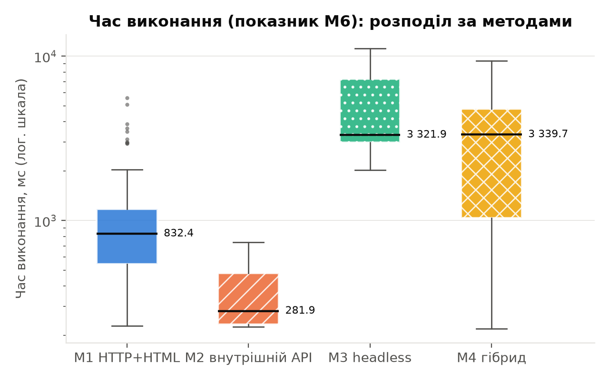

### M7 Пропускна здатність, зап./с

| Метод | n | Медіана | Середнє | SD | IQR | Q1 | Q3 | Min | Max | CV, % | 95% ДІ медіани |
|---|---|---|---|---|---|---|---|---|---|---|---|
| M1 | 110 | 28.832 | 30.38 | 27.988 | 43.266 | 0 | 43.266 | 0 | 104.442 | 92.126 | [21.39; 32.49] |
| M2 | 15 | 127.702 | 114.104 | 41.923 | 78.748 | 75.226 | 153.973 | 48.622 | 159.408 | 36.741 | [73.75; 154.53] |
| M3 | 110 | 11.36 | 11.844 | 4.483 | 4.442 | 9.641 | 14.082 | 4.308 | 23.716 | 37.851 | [10.85; 11.88] |
| M4 | 110 | 12.796 | 25.589 | 25.032 | 19.557 | 10.501 | 30.058 | 0 | 99.678 | 97.824 | [11.25; 17.91] |

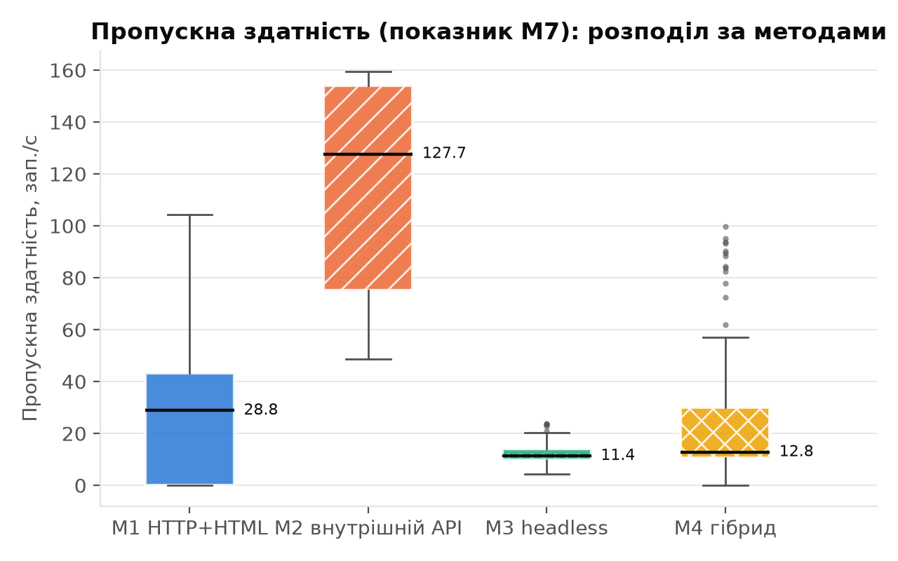

### M8 Мережевий трафік, МБ

| Метод | n | Медіана | Середнє | SD | IQR | Q1 | Q3 | Min | Max | CV, % | 95% ДІ медіани |
|---|---|---|---|---|---|---|---|---|---|---|---|
| M1 | 110 | 0.104 | 0.115 | 0.06 | 0.091 | 0.072 | 0.164 | 0.032 | 0.23 | 52.762 | [0.09; 0.14] |
| M2 | 15 | 0.036 | 0.037 | 0.004 | 0.01 | 0.032 | 0.042 | 0.032 | 0.042 | 11.823 | [0.03; 0.04] |
| M3 | 110 | 2.602 | 3.249 | 1.541 | 2.228 | 1.96 | 4.187 | 1.242 | 6.341 | 47.443 | [2.44; 3.24] |
| M4 | 110 | 1.166 | 2.187 | 2.353 | 3.923 | 0.139 | 4.062 | 0.006 | 6.462 | 107.576 | [0.20; 2.14] |

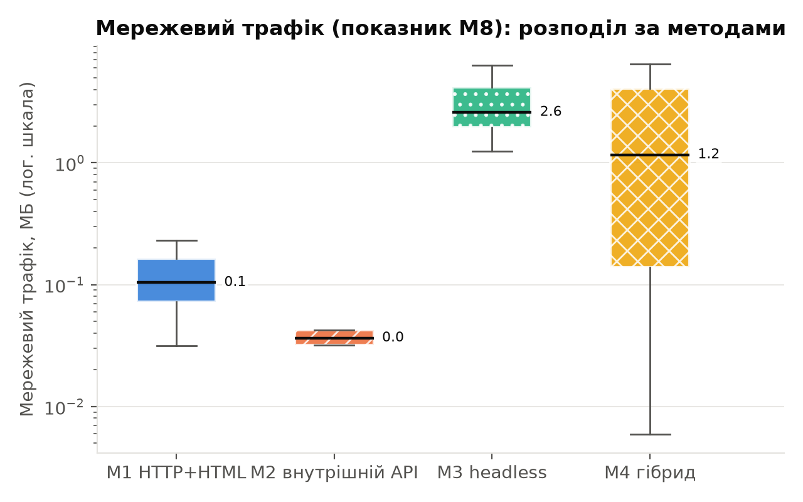

### M9 Пікова пам'ять, МБ

| Метод | n | Медіана | Середнє | SD | IQR | Q1 | Q3 | Min | Max | CV, % | 95% ДІ медіани |
|---|---|---|---|---|---|---|---|---|---|---|---|
| M1 | 110 | 165.985 | 165.929 | 8.71 | 12.113 | 160.575 | 172.688 | 138.07 | 185.49 | 5.249 | [163.49; 167.57] |
| M2 | 15 | 165.65 | 164.823 | 7.463 | 8.51 | 160.35 | 168.86 | 148 | 176.39 | 4.528 | [160.09; 168.95] |
| M3 | 110 | 736.89 | 750.853 | 136.684 | 98.12 | 675.252 | 773.372 | 550.04 | 1 314.47 | 18.204 | [723.26; 747.92] |
| M4 | 110 | 410.825 | 485.245 | 330.359 | 594.285 | 167.555 | 761.84 | 146.8 | 1 032.35 | 68.081 | [176.00; 681.85] |

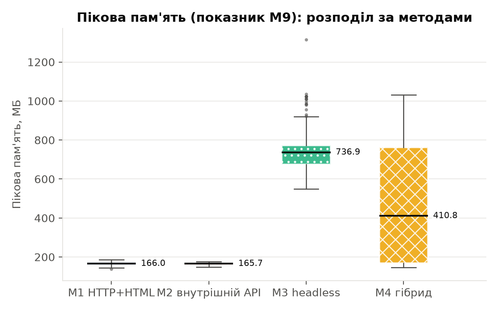

### M10 Процесорний час, с

| Метод | n | Медіана | Середнє | SD | IQR | Q1 | Q3 | Min | Max | CV, % | 95% ДІ медіани |
|---|---|---|---|---|---|---|---|---|---|---|---|
| M1 | 110 | 0.406 | 0.411 | 0.143 | 0.219 | 0.297 | 0.516 | 0.172 | 0.844 | 34.798 | [0.37; 0.42] |
| M2 | 15 | 0.203 | 0.221 | 0.033 | 0.047 | 0.203 | 0.25 | 0.172 | 0.281 | 15.093 | [0.20; 0.25] |
| M3 | 110 | 4.258 | 5.104 | 2.755 | 1.887 | 3.707 | 5.594 | 1.781 | 15.562 | 53.971 | [4.10; 4.58] |
| M4 | 110 | 2.164 | 3.505 | 3.765 | 4.355 | 0.438 | 4.793 | 0.203 | 12.219 | 107.423 | [0.51; 4.09] |

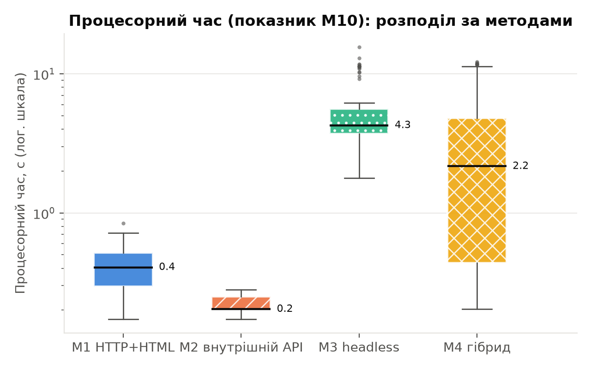

Викидів за правилом 1,5·IQR: **160** (перелік – аркуш «Викиди» в Excel). Викиди не видаляються автоматично: кожен перевіряється вручну, рішення – в журналі.

## 3.3 Перевірка нормальності (Шапіро–Вілк, рівень сторінок)

| Показник | Метод | n | W | p | Нормальний? |
|---|---|---|---|---|---|
| recall | M1 | 22 | 0.746 | < 0,001 | ні |
| recall | M2 | 3 | — | — | не визначено (мало різних значень) |
| recall | M3 | 22 | — | — | не визначено (мало різних значень) |
| recall | M4 | 22 | — | — | не визначено (мало різних значень) |
| precision | M1 | 22 | — | — | не визначено (мало різних значень) |
| precision | M2 | 3 | — | — | не визначено (мало різних значень) |
| precision | M3 | 22 | — | — | не визначено (мало різних значень) |
| precision | M4 | 22 | — | — | не визначено (мало різних значень) |
| f1 | M1 | 22 | 0.717 | < 0,001 | ні |
| f1 | M2 | 3 | — | — | не визначено (мало різних значень) |
| f1 | M3 | 22 | — | — | не визначено (мало різних значень) |
| f1 | M4 | 22 | — | — | не визначено (мало різних значень) |
| field_accuracy | M1 | 16 | 0.416 | < 0,001 | ні |
| field_accuracy | M2 | 3 | — | — | не визначено (мало різних значень) |
| field_accuracy | M3 | 22 | 0.422 | < 0,001 | ні |
| field_accuracy | M4 | 22 | 0.351 | < 0,001 | ні |
| t_ms | M1 | 22 | 0.726 | < 0,001 | ні |
| t_ms | M2 | 3 | 0.877 | 0,317 | так |
| t_ms | M3 | 22 | 0.803 | < 0,001 | ні |
| t_ms | M4 | 22 | 0.867 | 0,007 | ні |
| throughput | M1 | 22 | 0.874 | 0,009 | ні |
| throughput | M2 | 3 | 0.946 | 0,552 | так |
| throughput | M3 | 22 | 0.944 | 0,242 | так |
| throughput | M4 | 22 | 0.72 | < 0,001 | ні |
| traffic_mb | M1 | 22 | 0.94 | 0,193 | так |
| traffic_mb | M2 | 3 | 0.996 | 0,882 | так |
| traffic_mb | M3 | 22 | 0.862 | 0,006 | ні |
| traffic_mb | M4 | 22 | 0.804 | < 0,001 | ні |
| ram_peak_mb | M1 | 22 | 0.94 | 0,201 | так |
| ram_peak_mb | M2 | 3 | 0.949 | 0,566 | так |
| ram_peak_mb | M3 | 22 | 0.883 | 0,014 | ні |
| ram_peak_mb | M4 | 22 | 0.777 | < 0,001 | ні |
| cpu_s | M1 | 22 | 0.954 | 0,375 | так |
| cpu_s | M2 | 3 | — | — | не визначено (мало різних значень) |
| cpu_s | M3 | 22 | 0.766 | < 0,001 | ні |
| cpu_s | M4 | 22 | 0.777 | < 0,001 | ні |

Розподіл відхиляється від нормального у 44 % перевірок → застосовуються непараметричні критерії.

## 3.4 Порівняння методів: критерій Фрідмана

Політика для незастосовних методів у критеріях: **exclude** (exclude – лише сторінки, де застосовні всі методи; zero – повнота незастосовного методу = 0).

| Показник | N (сторінок) | k (методів) | Методи | χ² | p | W Кендалла | Примітка | Середні ранги |
|---|---|---|---|---|---|---|---|---|
| recall | 3 | 4 | M1, M2, M3, M4 | 9 | 0,029 | 1 |  | M1: 1.00; M2: 3.00; M3: 3.00; M4: 3.00 |
| precision | 3 | 4 | M1, M2, M3, M4 | 9 | 0,029 | 1 |  | M1: 1.00; M2: 3.00; M3: 3.00; M4: 3.00 |
| f1 | 3 | 4 | M1, M2, M3, M4 | 9 | 0,029 | 1 |  | M1: 1.00; M2: 3.00; M3: 3.00; M4: 3.00 |
| field_accuracy | 0 | 4 | M1, M2, M3, M4 | — | — | — | потрібно ≥3 методи і ≥2 сторінки | — |
| t_ms | 3 | 4 | M1, M2, M3, M4 | 8.2 | 0,042 | 0.911 |  | M1: 1.33; M2: 1.67; M3: 3.00; M4: 4.00 |
| throughput | 3 | 4 | M1, M2, M3, M4 | 9 | 0,029 | 1 |  | M1: 1.00; M2: 4.00; M3: 3.00; M4: 2.00 |
| traffic_mb | 3 | 4 | M1, M2, M3, M4 | 9 | 0,029 | 1 |  | M1: 1.00; M2: 2.00; M3: 3.00; M4: 4.00 |
| ram_peak_mb | 3 | 4 | M1, M2, M3, M4 | 8.2 | 0,042 | 0.911 |  | M1: 1.00; M2: 2.00; M3: 3.33; M4: 3.67 |
| cpu_s | 3 | 4 | M1, M2, M3, M4 | 7.4 | 0,060 | 0.822 |  | M1: 1.67; M2: 1.33; M3: 3.33; M4: 3.67 |

## 3.5 Попарні порівняння (Вілкоксон + Холм) – таблиці значущості

Суттєво = p (Холм) < 0,05 **і** |δ| ≥ 0,33 **і** перевищено поріг практичної значущості.

### M1 Повнота (Recall)

| Пара | Медіана A | Медіана B | Різниця (A−B) | Відношення A/B | p (сире) | p (Холм) | δ | Ефект | Практ. поріг | Суттєво? | N | p (Холм, усі показники) |
|---|---|---|---|---|---|---|---|---|---|---|---|---|
| M1 vs M2 | 0 | 100 | -100 | 0 | 0,250 | 1,000 | -1 | великий | так | ні | 3 | 1,000 |
| M1 vs M3 | 0 | 100 | -100 | 0 | 0,250 | 1,000 | -1 | великий | так | ні | 3 | 1,000 |
| M1 vs M4 | 0 | 100 | -100 | 0 | 0,250 | 1,000 | -1 | великий | так | ні | 3 | 1,000 |
| M2 vs M3 | 100 | 100 | 0 | 1 | 1,000 | 1,000 | 0 | мізерний | ні | ні | 3 | 1,000 |
| M2 vs M4 | 100 | 100 | 0 | 1 | 1,000 | 1,000 | 0 | мізерний | ні | ні | 3 | 1,000 |
| M3 vs M4 | 100 | 100 | 0 | 1 | 1,000 | 1,000 | 0 | мізерний | ні | ні | 3 | 1,000 |

### M2 Точність вилучення (Precision)

| Пара | Медіана A | Медіана B | Різниця (A−B) | Відношення A/B | p (сире) | p (Холм) | δ | Ефект | Практ. поріг | Суттєво? | N | p (Холм, усі показники) |
|---|---|---|---|---|---|---|---|---|---|---|---|---|
| M1 vs M2 | 0 | 100 | -100 | 0 | 0,250 | 1,000 | -1 | великий | так | ні | 3 | 1,000 |
| M1 vs M3 | 0 | 100 | -100 | 0 | 0,250 | 1,000 | -1 | великий | так | ні | 3 | 1,000 |
| M1 vs M4 | 0 | 100 | -100 | 0 | 0,250 | 1,000 | -1 | великий | так | ні | 3 | 1,000 |
| M2 vs M3 | 100 | 100 | 0 | 1 | 1,000 | 1,000 | 0 | мізерний | ні | ні | 3 | 1,000 |
| M2 vs M4 | 100 | 100 | 0 | 1 | 1,000 | 1,000 | 0 | мізерний | ні | ні | 3 | 1,000 |
| M3 vs M4 | 100 | 100 | 0 | 1 | 1,000 | 1,000 | 0 | мізерний | ні | ні | 3 | 1,000 |

### M3 F1-міра

| Пара | Медіана A | Медіана B | Різниця (A−B) | Відношення A/B | p (сире) | p (Холм) | δ | Ефект | Практ. поріг | Суттєво? | N | p (Холм, усі показники) |
|---|---|---|---|---|---|---|---|---|---|---|---|---|
| M1 vs M2 | 0 | 100 | -100 | 0 | 0,250 | 1,000 | -1 | великий | так | ні | 3 | 1,000 |
| M1 vs M3 | 0 | 100 | -100 | 0 | 0,250 | 1,000 | -1 | великий | так | ні | 3 | 1,000 |
| M1 vs M4 | 0 | 100 | -100 | 0 | 0,250 | 1,000 | -1 | великий | так | ні | 3 | 1,000 |
| M2 vs M3 | 100 | 100 | 0 | 1 | 1,000 | 1,000 | 0 | мізерний | ні | ні | 3 | 1,000 |
| M2 vs M4 | 100 | 100 | 0 | 1 | 1,000 | 1,000 | 0 | мізерний | ні | ні | 3 | 1,000 |
| M3 vs M4 | 100 | 100 | 0 | 1 | 1,000 | 1,000 | 0 | мізерний | ні | ні | 3 | 1,000 |

### M4 Точність поля «ціна»

| Пара | Медіана A | Медіана B | Різниця (A−B) | Відношення A/B | p (сире) | p (Холм) | δ | Ефект | Практ. поріг | Суттєво? | N | p (Холм, усі показники) |
|---|---|---|---|---|---|---|---|---|---|---|---|---|
| M1 vs M2 | — | — | — | — | 1,000 | 1,000 | — | — | — | ні | 0 | 1,000 |
| M1 vs M3 | — | — | — | — | 1,000 | 1,000 | — | — | — | ні | 0 | 1,000 |
| M1 vs M4 | — | — | — | — | 1,000 | 1,000 | — | — | — | ні | 0 | 1,000 |
| M2 vs M3 | — | — | — | — | 1,000 | 1,000 | — | — | — | ні | 0 | 1,000 |
| M2 vs M4 | — | — | — | — | 1,000 | 1,000 | — | — | — | ні | 0 | 1,000 |
| M3 vs M4 | — | — | — | — | 1,000 | 1,000 | — | — | — | ні | 0 | 1,000 |

### M6 Час виконання

| Пара | Медіана A | Медіана B | Різниця (A−B) | Відношення A/B | p (сире) | p (Холм) | δ | Ефект | Практ. поріг | Суттєво? | N | p (Холм, усі показники) |
|---|---|---|---|---|---|---|---|---|---|---|---|---|
| M1 vs M2 | 243.38 | 281.91 | -38.53 | 0.863 | 1,000 | 1,000 | -0.111 | мізерний | ні | ні | 3 | 1,000 |
| M1 vs M3 | 243.38 | 3 152.55 | -2 909.17 | 0.077 | 0,250 | 1,000 | -1 | великий | так | ні | 3 | 1,000 |
| M1 vs M4 | 243.38 | 3 430.12 | -3 186.74 | 0.071 | 0,250 | 1,000 | -1 | великий | так | ні | 3 | 1,000 |
| M2 vs M3 | 281.91 | 3 152.55 | -2 870.64 | 0.089 | 0,250 | 1,000 | -1 | великий | так | ні | 3 | 1,000 |
| M2 vs M4 | 281.91 | 3 430.12 | -3 148.21 | 0.082 | 0,250 | 1,000 | -1 | великий | так | ні | 3 | 1,000 |
| M3 vs M4 | 3 152.55 | 3 430.12 | -277.57 | 0.919 | 0,250 | 1,000 | -1 | великий | ні | ні | 3 | 1,000 |

### M7 Пропускна здатність

| Пара | Медіана A | Медіана B | Різниця (A−B) | Відношення A/B | p (сире) | p (Холм) | δ | Ефект | Практ. поріг | Суттєво? | N | p (Холм, усі показники) |
|---|---|---|---|---|---|---|---|---|---|---|---|---|
| M1 vs M2 | 0 | 127.702 | -127.702 | 0 | 0,250 | 1,000 | -1 | великий | так | ні | 3 | 1,000 |
| M1 vs M3 | 0 | 11.419 | -11.419 | 0 | 0,250 | 1,000 | -1 | великий | так | ні | 3 | 1,000 |
| M1 vs M4 | 0 | 10.495 | -10.495 | 0 | 0,250 | 1,000 | -1 | великий | так | ні | 3 | 1,000 |
| M2 vs M3 | 127.702 | 11.419 | 116.283 | 11.183 | 0,250 | 1,000 | 1 | великий | так | ні | 3 | 1,000 |
| M2 vs M4 | 127.702 | 10.495 | 117.207 | 12.168 | 0,250 | 1,000 | 1 | великий | так | ні | 3 | 1,000 |
| M3 vs M4 | 11.419 | 10.495 | 0.924 | 1.088 | 0,250 | 1,000 | 1 | великий | ні | ні | 3 | 1,000 |

### M8 Мережевий трафік

| Пара | Медіана A | Медіана B | Різниця (A−B) | Відношення A/B | p (сире) | p (Холм) | δ | Ефект | Практ. поріг | Суттєво? | N | p (Холм, усі показники) |
|---|---|---|---|---|---|---|---|---|---|---|---|---|
| M1 vs M2 | 0.032 | 0.036 | -0.005 | 0.871 | 0,250 | 1,000 | -0.778 | великий | ні | ні | 3 | 1,000 |
| M1 vs M3 | 0.032 | 3.736 | -3.704 | 0.009 | 0,250 | 1,000 | -1 | великий | так | ні | 3 | 1,000 |
| M1 vs M4 | 0.032 | 3.769 | -3.737 | 0.008 | 0,250 | 1,000 | -1 | великий | так | ні | 3 | 1,000 |
| M2 vs M3 | 0.036 | 3.736 | -3.699 | 0.01 | 0,250 | 1,000 | -1 | великий | так | ні | 3 | 1,000 |
| M2 vs M4 | 0.036 | 3.769 | -3.732 | 0.01 | 0,250 | 1,000 | -1 | великий | так | ні | 3 | 1,000 |
| M3 vs M4 | 3.736 | 3.769 | -0.033 | 0.991 | 0,250 | 1,000 | -0.333 | середній | ні | ні | 3 | 1,000 |

### M9 Пікова пам'ять

| Пара | Медіана A | Медіана B | Різниця (A−B) | Відношення A/B | p (сире) | p (Холм) | δ | Ефект | Практ. поріг | Суттєво? | N | p (Холм, усі показники) |
|---|---|---|---|---|---|---|---|---|---|---|---|---|
| M1 vs M2 | 159.97 | 165.65 | -5.68 | 0.966 | 0,250 | 1,000 | -1 | великий | ні | ні | 3 | 1,000 |
| M1 vs M3 | 159.97 | 675.14 | -515.17 | 0.237 | 0,250 | 1,000 | -1 | великий | так | ні | 3 | 1,000 |
| M1 vs M4 | 159.97 | 677.69 | -517.72 | 0.236 | 0,250 | 1,000 | -1 | великий | так | ні | 3 | 1,000 |
| M2 vs M3 | 165.65 | 675.14 | -509.49 | 0.245 | 0,250 | 1,000 | -1 | великий | так | ні | 3 | 1,000 |
| M2 vs M4 | 165.65 | 677.69 | -512.04 | 0.244 | 0,250 | 1,000 | -1 | великий | так | ні | 3 | 1,000 |
| M3 vs M4 | 675.14 | 677.69 | -2.55 | 0.996 | 0,500 | 1,000 | -0.333 | середній | ні | ні | 3 | 1,000 |

### M10 Процесорний час

| Пара | Медіана A | Медіана B | Різниця (A−B) | Відношення A/B | p (сире) | p (Холм) | δ | Ефект | Практ. поріг | Суттєво? | N | p (Холм, усі показники) |
|---|---|---|---|---|---|---|---|---|---|---|---|---|
| M1 vs M2 | 0.219 | 0.203 | 0.016 | 1.077 | 1,000 | 1,000 | 0.222 | малий | ні | ні | 3 | 1,000 |
| M1 vs M3 | 0.219 | 4.062 | -3.844 | 0.054 | 0,250 | 1,000 | -1 | великий | так | ні | 3 | 1,000 |
| M1 vs M4 | 0.219 | 4.156 | -3.937 | 0.053 | 0,250 | 1,000 | -1 | великий | так | ні | 3 | 1,000 |
| M2 vs M3 | 0.203 | 4.062 | -3.859 | 0.05 | 0,250 | 1,000 | -1 | великий | так | ні | 3 | 1,000 |
| M2 vs M4 | 0.203 | 4.156 | -3.953 | 0.049 | 0,250 | 1,000 | -1 | великий | так | ні | 3 | 1,000 |
| M3 vs M4 | 4.062 | 4.156 | -0.094 | 0.977 | 0,500 | 1,000 | -0.333 | середній | ні | ні | 3 | 1,000 |

## Гіпотеза 1: повнота і тип рендерингу

| Показник | Розрив | Група 1 | n1 | Медіана розриву 1 | Група 2 | n2 | Медіана розриву 2 | U | p (однобічний, 1 > 2) | δ | Ефект | Примітка |
|---|---|---|---|---|---|---|---|---|---|---|---|---|
| recall | M3 − M1 | spa | 6 | 100 | ssr | 11 | 0 | 66 | < 0,001 | 1 | великий |  |
| recall | M3 − M1 | hybrid | 5 | 50 | ssr | 11 | 0 | 55 | < 0,001 | 1 | великий |  |
| recall | M4 − M1 | spa | 6 | 100 | ssr | 11 | 0 | 66 | < 0,001 | 1 | великий |  |

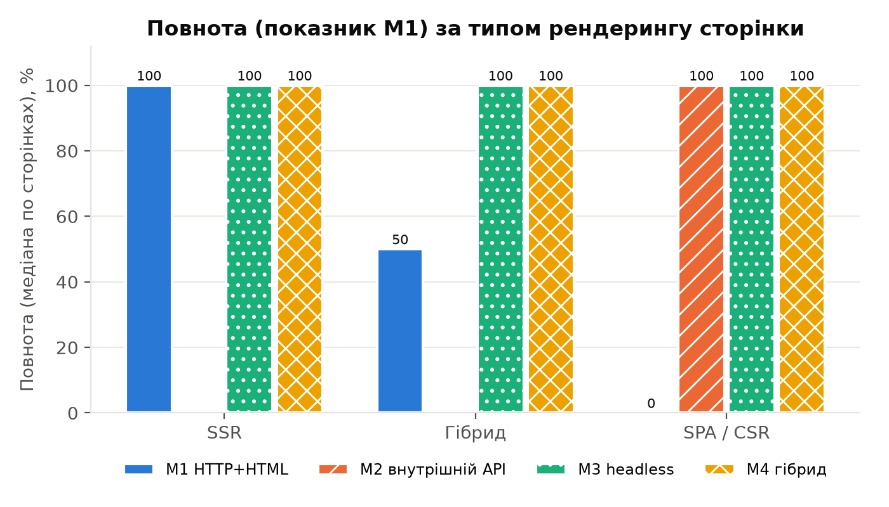

## Гіпотеза 2: ціна повноти (М3 відносно М1)

| Показник | Медіана М1 | Медіана М3 | М3/М1, разів | ≥ 10 разів? | p (Холм) | δ | Ефект |
|---|---|---|---|---|---|---|---|
| M6 Час виконання | 243.38 | 3 152.55 | 12.953 | так | 1,000 | -1 | великий |
| M8 Мережевий трафік | 0.032 | 3.736 | 117.478 | так | 1,000 | -1 | великий |
| M9 Пікова пам'ять | 159.97 | 675.14 | 4.22 | ні | 1,000 | -1 | великий |
| M10 Процесорний час | 0.219 | 4.062 | 18.567 | так | 1,000 | -1 | великий |

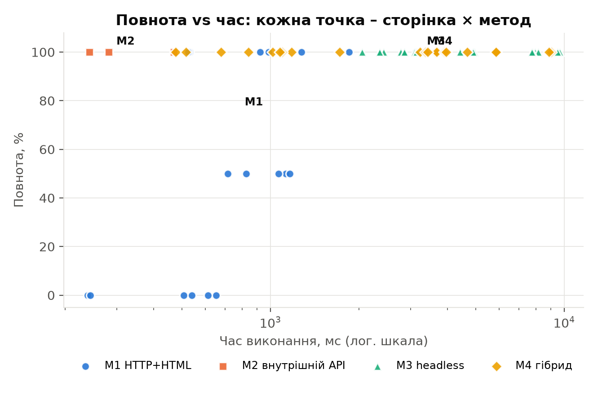

## Гіпотеза 3: стійкість до змін структури (M13)

_блок стійкості не виконано (див. `python -m wsbench stability-run`)_

## 3.7 Кореляційний аналіз (Спірмен)

| Зв'язок | Метод | n | ρ | p | Сила | Напрямок |
|---|---|---|---|---|---|---|
| кількість товарів ↔ час виконання | M1 | 22 | 0.206 | 0,359 | слабкий | прямий |
| кількість товарів ↔ час виконання | M3 | 22 | 0.453 | 0,034 | помірний | прямий |
| кількість товарів ↔ час виконання | M4 | 22 | 0.599 | 0,003 | помірний | прямий |
| обсяг початкового HTML ↔ повнота М1 | M1 | 22 | 0.414 | 0,055 | помірний | прямий |
| кількість XHR-запитів ↔ час М3 | M3 | 22 | 0.856 | < 0,001 | дуже сильний | прямий |
| кількість запитів ↔ трафік М3 | M3 | 22 | 0.727 | < 0,001 | сильний | прямий |

Пари показників з |ρ| > 0,9 (кандидати на надлишковість):

| Показник 1 | Показник 2 | ρ |
|---|---|---|
| recall | f1 | 1 |
| t_ms | cpu_s | 0.94 |

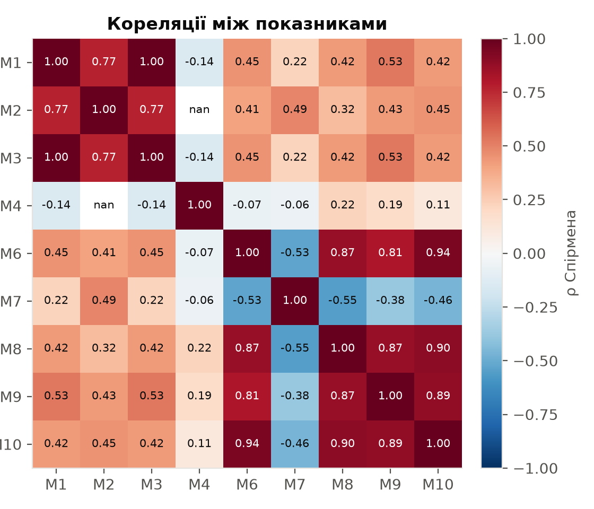

## M14 Трудомісткість підготовки

| method | LOC (медіана) | LOC (середнє) | сторінок |
|---|---|---|---|
| M1 | 3 | 3 | 3 |
| M2 | — | — | 0 |
| M3 | 3 | 3 | 3 |
| M4 | 4 | 4 | 3 |

## 3.8 Багатокритеріальне оцінювання

Політика незастосовності: **zero**.

### 3.8.1 Аналіз Парето

Значення показників:

| index | recall | precision | f1 | sr | t_ms | throughput | traffic_mb | ram_peak_mb | cpu_s | fr | antibot_hits | effort_loc |
|---|---|---|---|---|---|---|---|---|---|---|---|---|
| M1 | 75 | 100,000 | 83.335 | 50 | 770.895 | 28.25 | 0.104 | 165.405 | 0.383 | 50 | 0 | 3 |
| M2 | 0 | < 0,001 | 0 | 13.636 | 281.91 | 0 | 0.036 | 165.65 | 0.203 | 86.364 | 0 | — |
| M3 | 100 | 100,000 | 100 | 100 | 3 214.705 | 11.516 | 2.613 | 740.305 | 4.25 | 0 | 0 | 3 |
| M4 | 100 | 100,000 | 100 | 98.182 | 3 402.065 | 12.591 | 1.169 | 427.21 | 2.281 | 1.818 | 0.009 | 4 |

Не враховано (однакові для всіх методів, не розрізняють їх): field_accuracy

Матриця домінування (рядок домінує над стовпцем):

| index | M1 | M2 | M3 | M4 |
|---|---|---|---|---|
| M1 |  |  |  |  |
| M2 |  |  |  |  |
| M3 |  |  |  |  |
| M4 |  |  |  |  |

**Множина Парето:** M1, M2, M3, M4

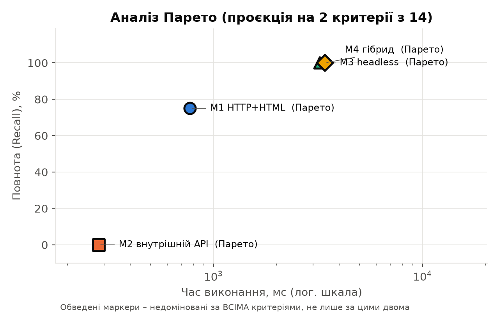

### Ваги AHP (Сааті)

| index | вага |
|---|---|
| K1 | 0.54 |
| K2 | 0.163 |
| K3 | 0.297 |

λmax = 3.0092; CI = 0.0046; CR = 0.0079 → узгоджено (CR < 0,1)

### 3.8.2 Інтегральний показник E (безрозмірний, 0–1)

| index | Рівні ваги | AHP (Сааті) | Повнота понад усе | Масовий моніторинг | Довготривала експлуатація |
|---|---|---|---|---|---|
| M1 | 0.838 | 0.801 | 0.783 | 0.861 | 0.817 |
| M2 | 0.378 | 0.23 | 0.147 | 0.45 | 0.31 |
| M3 | 0.698 | 0.852 | 0.909 | 0.547 | 0.819 |
| M4 | 0.576 | 0.7 | 0.802 | 0.601 | 0.576 |

Ранги:

| index | Рівні ваги | AHP (Сааті) | Повнота понад усе | Масовий моніторинг | Довготривала експлуатація |
|---|---|---|---|---|---|
| M1 | 1 | 2 | 3 | 1 | 2 |
| M2 | 4 | 4 | 4 | 4 | 4 |
| M3 | 2 | 1 | 1 | 3 | 1 |
| M4 | 3 | 3 | 2 | 2 | 3 |

Ваги сценаріїв (К1 / К2 / К3):

| index | K1 | K2 | K3 |
|---|---|---|---|
| Рівні ваги | 0.333 | 0.333 | 0.333 |
| AHP (Сааті) | 0.54 | 0.163 | 0.297 |
| Повнота понад усе | 0.7 | 0.1 | 0.2 |
| Масовий моніторинг | 0.35 | 0.5 | 0.15 |
| Довготривала експлуатація | 0.35 | 0.2 | 0.45 |

### 3.8.3 Аналіз чутливості

Збурення ваг окремих показників ±30 %:

| index | Перемог | Частка перемог, % |
|---|---|---|
| M1 | 8 | 0.8 |
| M2 | 0 | 0 |
| M3 | 992 | 99.2 |
| M4 | 0 | 0 |

Збурення ваг груп К1–К3 ±30 %:

| index | Перемог | Частка перемог, % |
|---|---|---|
| M1 | 86 | 8.6 |
| M2 | 0 | 0 |
| M3 | 914 | 91.4 |
| M4 | 0 | 0 |

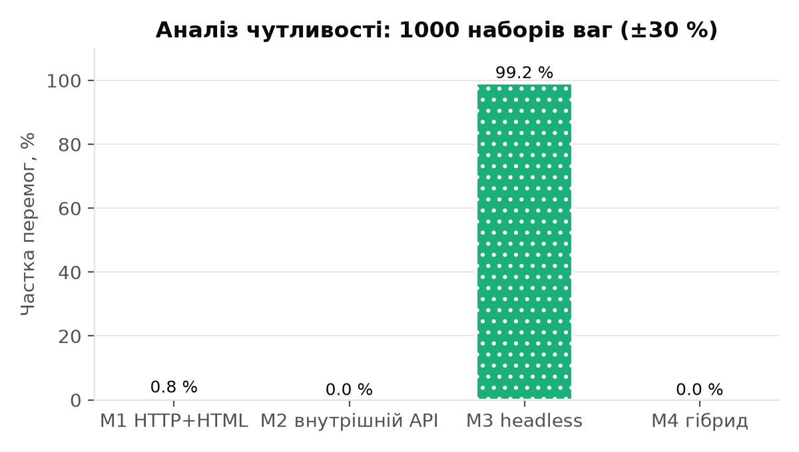

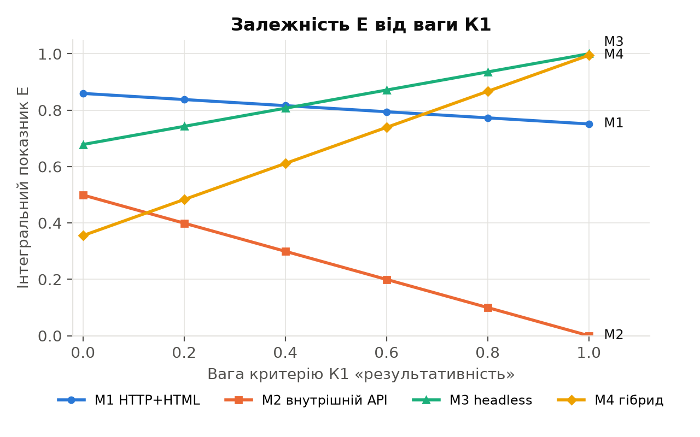
