# Результати експерименту

Журнал: `results/main_v2/runs.csv`  
Сформовано: 2026-11-16 19:06  

## 3.1 Характеристика масиву даних

| Прогонів | Сторінок | Сайтів | Методів | Повторів |
|---|---|---|---|---|
| 330 | 22 | 10 | 3 | 5 |

Страти за типом рендерингу:

| render_type | сторінок |
|---|---|
| hybrid | 5 |
| spa | 6 |
| ssr | 11 |

Розклад неуспішних прогонів за причинами (M11):

| method | HTTP 429 | Recall < 90 % | порожній результат | усього прогонів |
|---|---|---|---|---|
| M1 | 0 | 25 | 30 | 110 |
| M4 | 1 | 1 | 0 | 110 |

Застосовність методів (частка сторінок, де метод можна було запустити):

| index | Застосовність, % |
|---|---|
| M1 | 100 |
| M3 | 100 |
| M4 | 100 |

## 3.2 Описова статистика показників за методами

### M1 Повнота (Recall), %

| Метод | n | Медіана | Середнє | SD | IQR | Q1 | Q3 | Min | Max | CV, % | 95% ДІ медіани |
|---|---|---|---|---|---|---|---|---|---|---|---|
| M1 | 110 | 75 | 61.364 | 42.652 | 100 | 0 | 100 | 0 | 100 | 69.508 | [50.00; 100.00] |
| M3 | 110 | 100 | 99.962 | 0.279 | 0 | 100 | 100 | 97.92 | 100 | 0.279 | [100.00; 100.00] |
| M4 | 110 | 100 | 98.314 | 12.354 | 0 | 100 | 100 | 0 | 100 | 12.566 | [100.00; 100.00] |

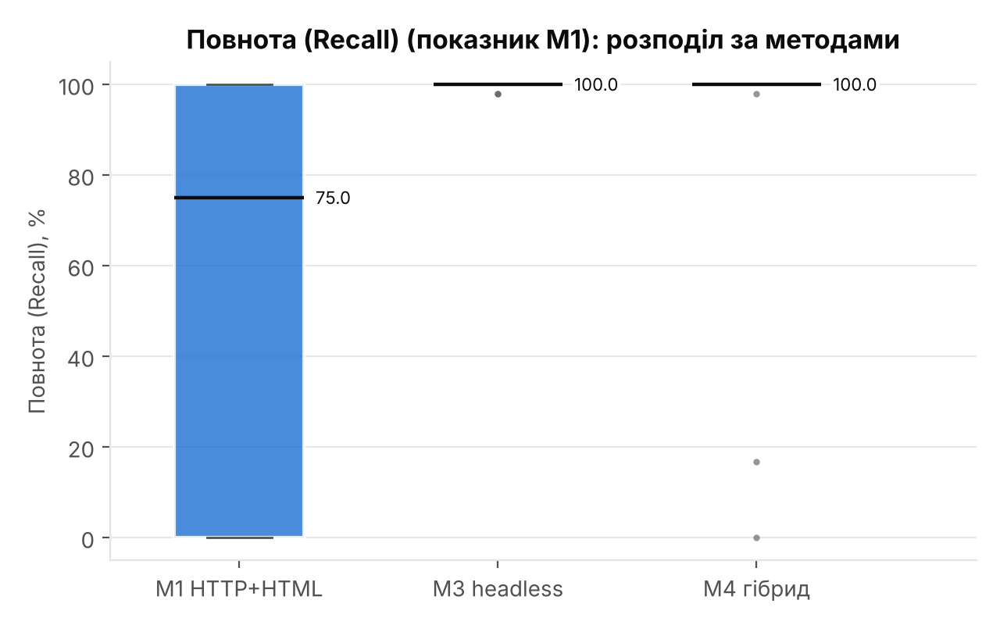

### M2 Точність вилучення (Precision), %

| Метод | n | Медіана | Середнє | SD | IQR | Q1 | Q3 | Min | Max | CV, % | 95% ДІ медіани |
|---|---|---|---|---|---|---|---|---|---|---|---|
| M1 | 110 | 100 | 72.727 | 44.74 | 100 | 0 | 100 | 0 | 100 | 61.518 | [100.00; 100.00] |
| M3 | 110 | 100 | 99.962 | 0.279 | 0 | 100 | 100 | 97.92 | 100 | 0.279 | [100.00; 100.00] |
| M4 | 110 | 100 | 98.314 | 12.354 | 0 | 100 | 100 | 0 | 100 | 12.566 | [100.00; 100.00] |

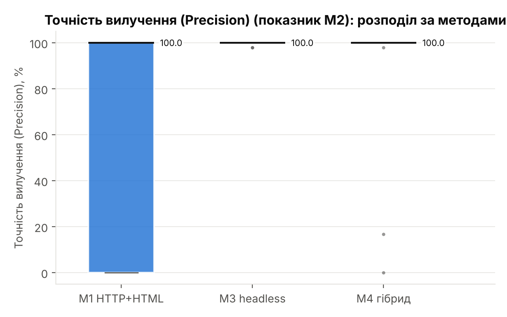

### M3 F1-міра, %

| Метод | n | Медіана | Середнє | SD | IQR | Q1 | Q3 | Min | Max | CV, % | 95% ДІ медіани |
|---|---|---|---|---|---|---|---|---|---|---|---|
| M1 | 110 | 83.335 | 65.152 | 42.209 | 100 | 0 | 100 | 0 | 100 | 64.785 | [66.67; 100.00] |
| M3 | 110 | 100 | 99.962 | 0.279 | 0 | 100 | 100 | 97.92 | 100 | 0.279 | [100.00; 100.00] |
| M4 | 110 | 100 | 98.314 | 12.354 | 0 | 100 | 100 | 0 | 100 | 12.566 | [100.00; 100.00] |

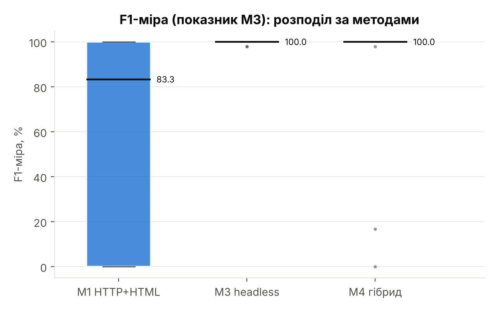

### M4 Точність поля «ціна», %

| Метод | n | Медіана | Середнє | SD | IQR | Q1 | Q3 | Min | Max | CV, % | 95% ДІ медіани |
|---|---|---|---|---|---|---|---|---|---|---|---|
| M1 | 80 | 100 | 87.162 | 33.166 | 0.52 | 99.48 | 100 | 0 | 100 | 38.051 | [100.00; 100.00] |
| M3 | 110 | 100 | 99.62 | 1.026 | 0 | 100 | 100 | 95.83 | 100 | 1.03 | [100.00; 100.00] |
| M4 | 109 | 100 | 99.044 | 6.038 | 0 | 100 | 100 | 37.5 | 100 | 6.096 | [100.00; 100.00] |

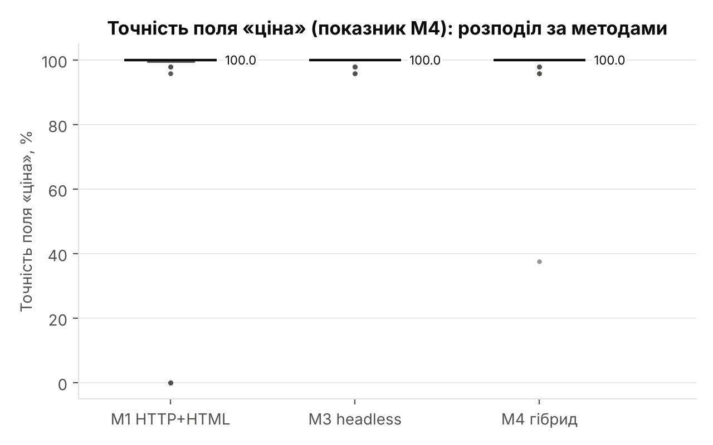

### M6 Час виконання, мс

| Метод | n | Медіана | Середнє | SD | IQR | Q1 | Q3 | Min | Max | CV, % | 95% ДІ медіани |
|---|---|---|---|---|---|---|---|---|---|---|---|
| M1 | 110 | 832.43 | 1 098.8 | 951.443 | 633.745 | 542.025 | 1 175.77 | 228.66 | 5 569.39 | 86.589 | [679.70; 966.63] |
| M3 | 110 | 3 321.94 | 4 777.556 | 2 531.269 | 4 291.125 | 2 985.562 | 7 276.688 | 2 023.96 | 11 141.6 | 52.983 | [3150.34; 4356.54] |
| M4 | 110 | 3 684.77 | 4 022.93 | 2 630.927 | 3 636.842 | 1 736.638 | 5 373.48 | 219.65 | 9 374.67 | 65.398 | [3237.88; 4014.61] |

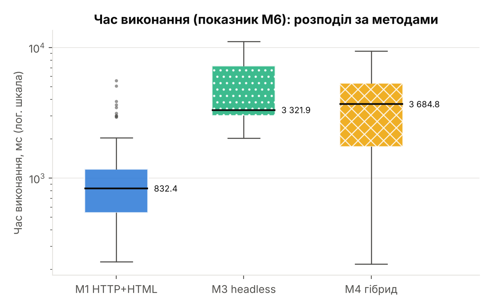

### M7 Пропускна здатність, зап./с

| Метод | n | Медіана | Середнє | SD | IQR | Q1 | Q3 | Min | Max | CV, % | 95% ДІ медіани |
|---|---|---|---|---|---|---|---|---|---|---|---|
| M1 | 110 | 28.832 | 30.38 | 27.988 | 43.266 | 0 | 43.266 | 0 | 104.442 | 92.126 | [21.39; 32.49] |
| M3 | 110 | 11.36 | 11.844 | 4.483 | 4.442 | 9.641 | 14.082 | 4.308 | 23.716 | 37.851 | [10.85; 11.88] |
| M4 | 110 | 11.718 | 18.917 | 18.152 | 11.579 | 10.268 | 21.847 | 0 | 89.541 | 95.959 | [10.93; 12.96] |

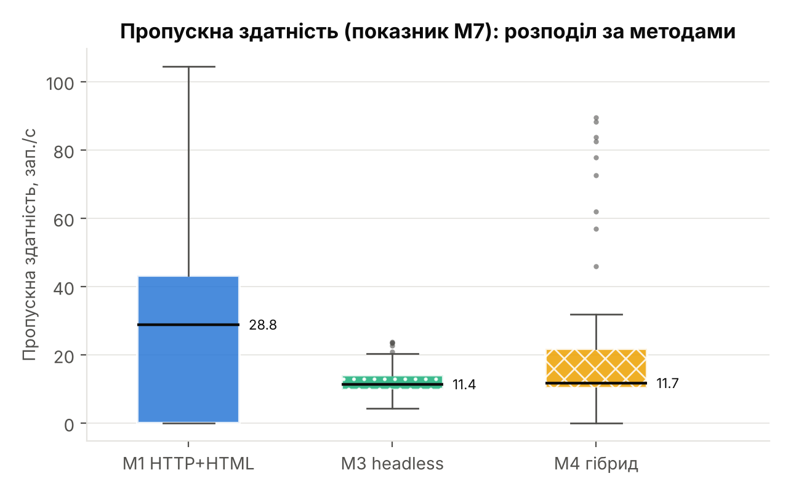

### M8 Мережевий трафік, МБ

| Метод | n | Медіана | Середнє | SD | IQR | Q1 | Q3 | Min | Max | CV, % | 95% ДІ медіани |
|---|---|---|---|---|---|---|---|---|---|---|---|
| M1 | 110 | 0.104 | 0.115 | 0.06 | 0.091 | 0.072 | 0.164 | 0.032 | 0.23 | 52.762 | [0.09; 0.14] |
| M3 | 110 | 2.602 | 3.249 | 1.541 | 2.228 | 1.96 | 4.187 | 1.242 | 6.341 | 47.443 | [2.44; 3.24] |
| M4 | 110 | 2.114 | 2.536 | 2.255 | 4.102 | 0.194 | 4.296 | 0.006 | 6.462 | 88.898 | [1.69; 2.93] |

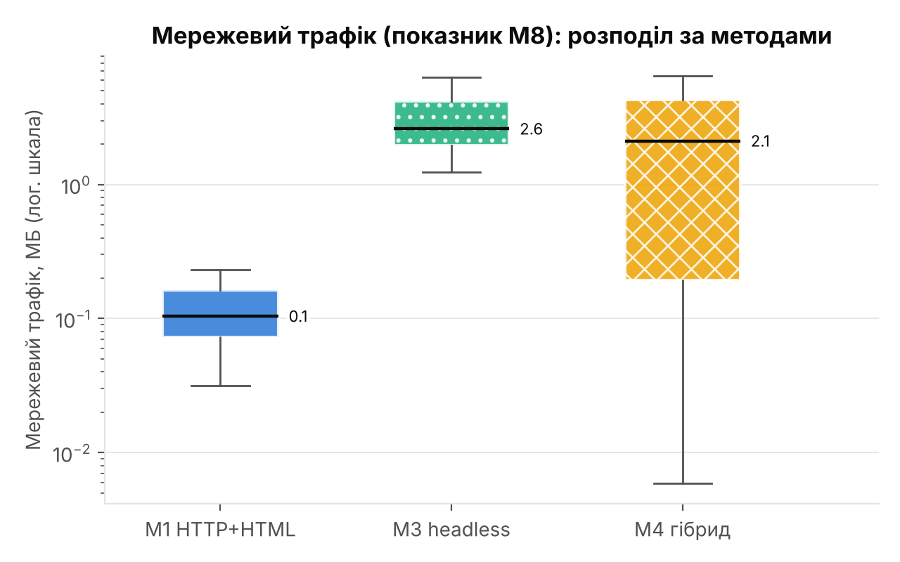

### M9 Приріст пам'яті над базою, МБ

| Метод | n | Медіана | Середнє | SD | IQR | Q1 | Q3 | Min | Max | CV, % | 95% ДІ медіани |
|---|---|---|---|---|---|---|---|---|---|---|---|
| M1 | 110 | 4.42 | 5.652 | 4.867 | 5.58 | 1.638 | 7.218 | 0.02 | 18.19 | 86.114 | [3.73; 5.52] |
| M3 | 110 | 575.255 | 589.651 | 135.69 | 90.602 | 517.003 | 607.605 | 365.57 | 1 146.42 | 23.012 | [564.21; 588.83] |
| M4 | 110 | 509.74 | 385.031 | 306.502 | 583.85 | 13.177 | 597.028 | 0.03 | 871.66 | 79.604 | [402.84; 543.33] |

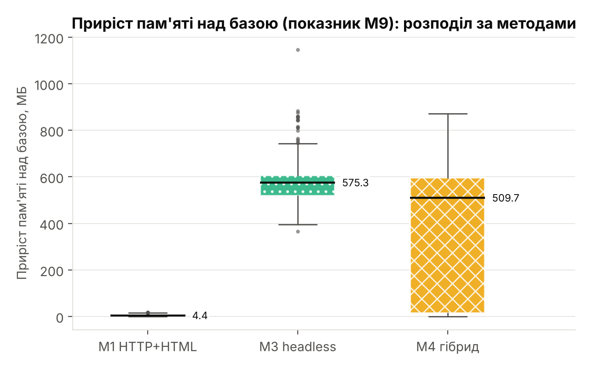

### M10 Процесорний час, с

| Метод | n | Медіана | Середнє | SD | IQR | Q1 | Q3 | Min | Max | CV, % | 95% ДІ медіани |
|---|---|---|---|---|---|---|---|---|---|---|---|
| M1 | 110 | 0.406 | 0.411 | 0.143 | 0.219 | 0.297 | 0.516 | 0.172 | 0.844 | 34.798 | [0.37; 0.42] |
| M3 | 110 | 4.258 | 5.104 | 2.755 | 1.887 | 3.707 | 5.594 | 1.781 | 15.562 | 53.971 | [4.10; 4.58] |
| M4 | 110 | 3.922 | 3.903 | 3.582 | 4.391 | 0.5 | 4.891 | 0.203 | 12.219 | 91.792 | [2.48; 4.34] |

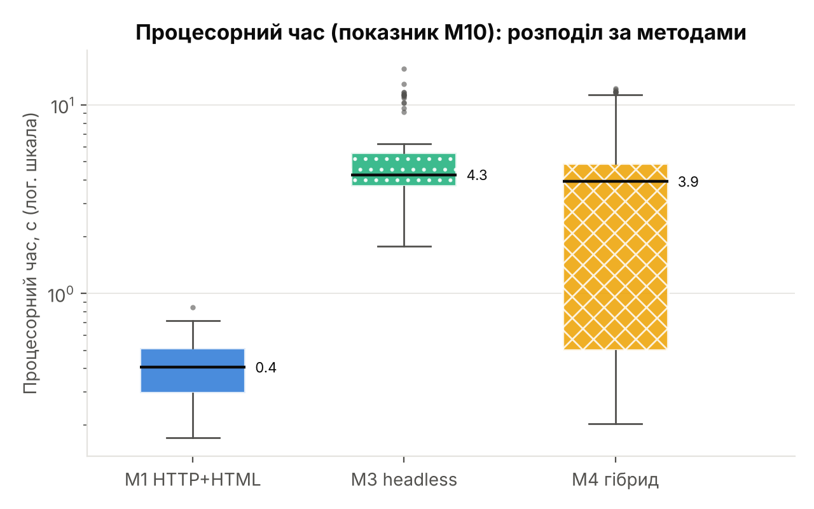

Викидів за правилом 1,5·IQR: **158** (перелік – аркуш «Викиди» в Excel). Викиди не видаляються автоматично: кожен перевіряється вручну, рішення – в журналі.

## 3.3 Перевірка нормальності (Шапіро–Вілк, рівень сторінок)

| Показник | Метод | n | W | p | Нормальний? |
|---|---|---|---|---|---|
| recall | M1 | 22 | 0.746 | < 0,001 | ні |
| recall | M3 | 22 | — | — | не визначено (мало різних значень) |
| recall | M4 | 22 | — | — | не визначено (мало різних значень) |
| precision | M1 | 22 | — | — | не визначено (мало різних значень) |
| precision | M3 | 22 | — | — | не визначено (мало різних значень) |
| precision | M4 | 22 | — | — | не визначено (мало різних значень) |
| f1 | M1 | 22 | 0.717 | < 0,001 | ні |
| f1 | M3 | 22 | — | — | не визначено (мало різних значень) |
| f1 | M4 | 22 | — | — | не визначено (мало різних значень) |
| field_accuracy | M1 | 16 | 0.416 | < 0,001 | ні |
| field_accuracy | M3 | 22 | 0.422 | < 0,001 | ні |
| field_accuracy | M4 | 22 | 0.422 | < 0,001 | ні |
| t_ms | M1 | 22 | 0.726 | < 0,001 | ні |
| t_ms | M3 | 22 | 0.803 | < 0,001 | ні |
| t_ms | M4 | 22 | 0.904 | 0,036 | ні |
| throughput | M1 | 22 | 0.874 | 0,009 | ні |
| throughput | M3 | 22 | 0.944 | 0,242 | так |
| throughput | M4 | 22 | 0.626 | < 0,001 | ні |
| traffic_mb | M1 | 22 | 0.94 | 0,193 | так |
| traffic_mb | M3 | 22 | 0.862 | 0,006 | ні |
| traffic_mb | M4 | 22 | 0.869 | 0,008 | ні |
| ram_delta_mb | M1 | 22 | 0.841 | 0,002 | ні |
| ram_delta_mb | M3 | 22 | 0.878 | 0,011 | ні |
| ram_delta_mb | M4 | 22 | 0.836 | 0,002 | ні |
| cpu_s | M1 | 22 | 0.954 | 0,375 | так |
| cpu_s | M3 | 22 | 0.766 | < 0,001 | ні |
| cpu_s | M4 | 22 | 0.828 | 0,001 | ні |

Розподіл відхиляється від нормального у 63 % перевірок → застосовуються непараметричні критерії.

## 3.4 Порівняння методів: критерій Фрідмана

Політика для незастосовних методів у критеріях: **exclude** (exclude – лише сторінки, де застосовні всі методи; zero – повнота незастосовного методу = 0).

| Показник | N (сторінок) | k (методів) | Методи | χ² | p | W Кендалла | Примітка | Середні ранги |
|---|---|---|---|---|---|---|---|---|
| recall | 22 | 3 | M1, M3, M4 | 22 | < 0,001 | 0.5 |  | M1: 1.50; M3: 2.25; M4: 2.25 |
| precision | 22 | 3 | M1, M3, M4 | 12 | 0,002 | 0.273 |  | M1: 1.73; M3: 2.14; M4: 2.14 |
| f1 | 22 | 3 | M1, M3, M4 | 22 | < 0,001 | 0.5 |  | M1: 1.50; M3: 2.25; M4: 2.25 |
| field_accuracy | 16 | 3 | M1, M3, M4 | 0.667 | 0,717 | 0.021 |  | M1: 1.94; M3: 2.03; M4: 2.03 |
| t_ms | 22 | 3 | M1, M3, M4 | 22.182 | < 0,001 | 0.504 |  | M1: 1.18; M3: 2.36; M4: 2.45 |
| throughput | 22 | 3 | M1, M3, M4 | 2.545 | 0,280 | 0.058 |  | M1: 2.27; M3: 1.91; M4: 1.82 |
| traffic_mb | 22 | 3 | M1, M3, M4 | 22.193 | < 0,001 | 0.504 |  | M1: 1.20; M3: 2.36; M4: 2.43 |
| ram_delta_mb | 22 | 3 | M1, M3, M4 | 30.368 | < 0,001 | 0.69 |  | M1: 1.09; M3: 2.70; M4: 2.20 |
| cpu_s | 22 | 3 | M1, M3, M4 | 23.655 | < 0,001 | 0.538 |  | M1: 1.16; M3: 2.45; M4: 2.39 |

## 3.5 Попарні порівняння (Вілкоксон + Холм) – таблиці значущості

Суттєво = p (Холм) < 0,05 **і** |δ| ≥ 0,33 **і** перевищено поріг практичної значущості.

### M1 Повнота (Recall)

| Пара | Медіана A | Медіана B | Різниця (A−B) | Відношення A/B | p (сире) | p (Холм) | δ | Ефект | Практ. поріг | Суттєво? | N | p (Холм, усі показники) |
|---|---|---|---|---|---|---|---|---|---|---|---|---|
| M1 vs M3 | 75 | 100 | -25 | 0.75 | 0,003 | 0,008 | -0.5 | великий | так | так | 22 | 0,046 |
| M1 vs M4 | 75 | 100 | -25 | 0.75 | 0,003 | 0,008 | -0.5 | великий | так | так | 22 | 0,046 |
| M3 vs M4 | 100 | 100 | 0 | 1 | 1,000 | 1,000 | 0 | мізерний | ні | ні | 22 | 1,000 |

### M2 Точність вилучення (Precision)

| Пара | Медіана A | Медіана B | Різниця (A−B) | Відношення A/B | p (сире) | p (Холм) | δ | Ефект | Практ. поріг | Суттєво? | N | p (Холм, усі показники) |
|---|---|---|---|---|---|---|---|---|---|---|---|---|
| M1 vs M3 | 100 | 100 | 0 | 1 | 0,014 | 0,043 | -0.273 | малий | ні | ні | 22 | 0,186 |
| M1 vs M4 | 100 | 100 | 0 | 1 | 0,014 | 0,043 | -0.273 | малий | ні | ні | 22 | 0,186 |
| M3 vs M4 | 100 | 100 | 0 | 1 | 1,000 | 1,000 | 0 | мізерний | ні | ні | 22 | 1,000 |

### M3 F1-міра

| Пара | Медіана A | Медіана B | Різниця (A−B) | Відношення A/B | p (сире) | p (Холм) | δ | Ефект | Практ. поріг | Суттєво? | N | p (Холм, усі показники) |
|---|---|---|---|---|---|---|---|---|---|---|---|---|
| M1 vs M3 | 83.335 | 100 | -16.665 | 0.833 | 0,003 | 0,008 | -0.5 | великий | так | так | 22 | 0,046 |
| M1 vs M4 | 83.335 | 100 | -16.665 | 0.833 | 0,003 | 0,008 | -0.5 | великий | так | так | 22 | 0,046 |
| M3 vs M4 | 100 | 100 | 0 | 1 | 1,000 | 1,000 | 0 | мізерний | ні | ні | 22 | 1,000 |

### M4 Точність поля «ціна»

| Пара | Медіана A | Медіана B | Різниця (A−B) | Відношення A/B | p (сире) | p (Холм) | δ | Ефект | Практ. поріг | Суттєво? | N | p (Холм, усі показники) |
|---|---|---|---|---|---|---|---|---|---|---|---|---|
| M1 vs M3 | 100 | 100 | 0 | 1 | 0,276 | 0,829 | -0.09 | мізерний | ні | ні | 16 | 1,000 |
| M1 vs M4 | 100 | 100 | 0 | 1 | 0,276 | 0,829 | -0.09 | мізерний | ні | ні | 16 | 1,000 |
| M3 vs M4 | 100 | 100 | 0 | 1 | 1,000 | 1,000 | 0 | мізерний | ні | ні | 16 | 1,000 |

### M6 Час виконання

| Пара | Медіана A | Медіана B | Різниця (A−B) | Відношення A/B | p (сире) | p (Холм) | δ | Ефект | Практ. поріг | Суттєво? | N | p (Холм, усі показники) |
|---|---|---|---|---|---|---|---|---|---|---|---|---|
| M1 vs M3 | 770.895 | 3 214.705 | -2 443.81 | 0.24 | < 0,001 | < 0,001 | -0.913 | великий | так | так | 22 | < 0,001 |
| M1 vs M4 | 770.895 | 3 537.935 | -2 767.04 | 0.218 | < 0,001 | < 0,001 | -0.74 | великий | так | так | 22 | 0,003 |
| M3 vs M4 | 3 214.705 | 3 537.935 | -323.23 | 0.909 | 0,503 | 0,503 | 0.07 | мізерний | ні | ні | 22 | 1,000 |

### M7 Пропускна здатність

| Пара | Медіана A | Медіана B | Різниця (A−B) | Відношення A/B | p (сире) | p (Холм) | δ | Ефект | Практ. поріг | Суттєво? | N | p (Холм, усі показники) |
|---|---|---|---|---|---|---|---|---|---|---|---|---|
| M1 vs M3 | 28.25 | 11.516 | 16.734 | 2.453 | 0,002 | 0,007 | 0.405 | середній | так | так | 22 | 0,042 |
| M1 vs M4 | 28.25 | 12.213 | 16.037 | 2.313 | 0,156 | 0,312 | 0.252 | малий | так | ні | 22 | 1,000 |
| M3 vs M4 | 11.516 | 12.213 | -0.697 | 0.943 | 0,503 | 0,503 | -0.174 | малий | ні | ні | 22 | 1,000 |

### M8 Мережевий трафік

| Пара | Медіана A | Медіана B | Різниця (A−B) | Відношення A/B | p (сире) | p (Холм) | δ | Ефект | Практ. поріг | Суттєво? | N | p (Холм, усі показники) |
|---|---|---|---|---|---|---|---|---|---|---|---|---|
| M1 vs M3 | 0.104 | 2.613 | -2.509 | 0.04 | < 0,001 | < 0,001 | -1 | великий | так | так | 22 | < 0,001 |
| M1 vs M4 | 0.104 | 2.122 | -2.018 | 0.049 | < 0,001 | 0,001 | -0.742 | великий | так | так | 22 | 0,012 |
| M3 vs M4 | 2.613 | 2.122 | 0.491 | 1.231 | 0,503 | 0,503 | 0.215 | малий | ні | ні | 22 | 1,000 |

### M9 Приріст пам'яті над базою

| Пара | Медіана A | Медіана B | Різниця (A−B) | Відношення A/B | p (сире) | p (Холм) | δ | Ефект | Практ. поріг | Суттєво? | N | p (Холм, усі показники) |
|---|---|---|---|---|---|---|---|---|---|---|---|---|
| M1 vs M3 | 4.415 | 577.26 | -572.845 | 0.008 | < 0,001 | < 0,001 | -1 | великий | так | так | 22 | < 0,001 |
| M1 vs M4 | 4.415 | 511.03 | -506.615 | 0.009 | < 0,001 | < 0,001 | -0.843 | великий | так | так | 22 | < 0,001 |
| M3 vs M4 | 577.26 | 511.03 | 66.23 | 1.13 | 0,006 | 0,006 | 0.357 | середній | ні | ні | 22 | 0,089 |

### M10 Процесорний час

| Пара | Медіана A | Медіана B | Різниця (A−B) | Відношення A/B | p (сире) | p (Холм) | δ | Ефект | Практ. поріг | Суттєво? | N | p (Холм, усі показники) |
|---|---|---|---|---|---|---|---|---|---|---|---|---|
| M1 vs M3 | 0.383 | 4.25 | -3.867 | 0.09 | < 0,001 | < 0,001 | -1 | великий | так | так | 22 | < 0,001 |
| M1 vs M4 | 0.383 | 4.055 | -3.672 | 0.094 | < 0,001 | < 0,001 | -0.779 | великий | так | так | 22 | 0,004 |
| M3 vs M4 | 4.25 | 4.055 | 0.195 | 1.048 | 0,406 | 0,406 | 0.238 | малий | ні | ні | 22 | 1,000 |

## Гіпотеза 1: повнота і тип рендерингу

| Показник | Розрив | Група 1 | n1 | Медіана розриву 1 | Група 2 | n2 | Медіана розриву 2 | U | p (однобічний, 1 > 2) | δ | Ефект | Примітка |
|---|---|---|---|---|---|---|---|---|---|---|---|---|
| recall | M3 − M1 | spa | 6 | 100 | ssr | 11 | 0 | 66 | < 0,001 | 1 | великий |  |
| recall | M3 − M1 | hybrid | 5 | 50 | ssr | 11 | 0 | 55 | < 0,001 | 1 | великий |  |
| recall | M4 − M1 | spa | 6 | 100 | ssr | 11 | 0 | 66 | < 0,001 | 1 | великий |  |

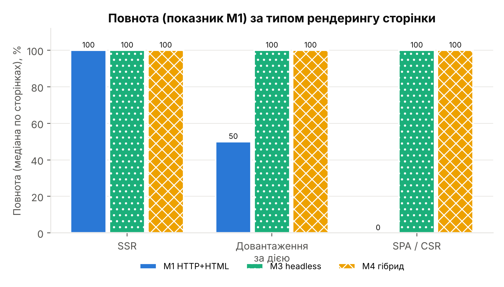

## Результати на рівні магазинів (незалежна одиниця – магазин)

Сторінки одного магазину мають спільну верстку й селектори, тому вони не є незалежними спостереженнями; нижче – медіани по магазину і критерії на N = кількість магазинів.

| site | сторінок | тип | recall · M1 | recall · M3 | recall · M4 | field_accuracy · M1 | field_accuracy · M3 | field_accuracy · M4 | t_ms · M1 | t_ms · M3 | t_ms · M4 | traffic_mb · M1 | traffic_mb · M3 | traffic_mb · M4 | ram_delta_mb · M1 | ram_delta_mb · M3 | ram_delta_mb · M4 | cpu_s · M1 | cpu_s · M3 | cpu_s · M4 |
|---|---|---|---|---|---|---|---|---|---|---|---|---|---|---|---|---|---|---|---|---|
| boulanger.com | 1 | ssr | 100 | 100 | 100 | 100 | 100 | 100 | 1 851.2 | 7 951.42 | 1 722.2 | 0.13 | 2.77 | 0.13 | 5.57 | 750.15 | 6.08 | 0.53 | 5.09 | 0.52 |
| eldorado.ua | 1 | ssr | 100 | 100 | 100 | 100 | 100 | 100 | 984.3 | 4 423.62 | 5 317.56 | 0.19 | 4.36 | 4.55 | 6.67 | 559.87 | 559.87 | 0.34 | 4.36 | 4.8 |
| foxtrot.com.ua | 2 | ssr | 100 | 100 | 100 | 100 | 100 | 100 | 531.44 | 2 393.94 | 577.22 | 0.07 | 1.7 | 0.07 | 4.55 | 438.31 | 5.95 | 0.41 | 2.69 | 0.41 |
| hotline.ua | 2 | ssr | 100 | 100 | 100 | 96.88 | 96.88 | 96.88 | 3 387.72 | 9 580.74 | 3 439.71 | 0.14 | 2.28 | 0.14 | 6.39 | 580.58 | 5.91 | 0.55 | 5.78 | 0.57 |
| ldlc.com | 2 | ssr | 100 | 100 | 100 | 0 | 100 | 100 | 522.86 | 2 201.68 | 2 908.16 | 0.04 | 1.66 | 1.69 | 3.35 | 403.31 | 403.32 | 0.33 | 2.12 | 2.46 |
| moyo.ua | 2 | hybrid | 50 | 100 | 100 | 100 | 100 | 100 | 770.9 | 4 922.3 | 5 851.18 | 0.1 | 4.89 | 4.99 | 1.73 | 594.81 | 595.32 | 0.41 | 5.59 | 6.05 |
| power.fi | 3 | spa | 0 | 100 | 100 | — | 100 | 100 | 243.38 | 3 152.55 | 3 430.12 | 0.03 | 3.74 | 3.77 | 0.5 | 514.08 | 512.73 | 0.22 | 4.06 | 4.16 |
| telemart.ua | 3 | hybrid | 50 | 100 | 100 | 100 | 100 | 100 | 1 127.02 | 7 825.83 | 8 938.21 | 0.09 | 6.03 | 6.13 | 6.38 | 846.43 | 834.87 | 0.64 | 11.27 | 11.3 |
| verkkokauppa.com | 3 | spa | 0 | 100 | 100 | — | 100 | 100 | 613.79 | 3 201.95 | 3 955.31 | 0.16 | 1.97 | 2.14 | 1.62 | 607.59 | 611.84 | 0.27 | 4.09 | 4.52 |
| x-kom.pl | 3 | ssr | 100 | 100 | 100 | 100 | 100 | 100 | 1 092.49 | 2 856.52 | 1 074.89 | 0.2 | 2.6 | 0.2 | 14.59 | 576.71 | 15.69 | 0.41 | 4.17 | 0.45 |

| Показник | Пара | N магазинів | Медіана A | Медіана B | p | δ | p (Холм) | Ефект |
|---|---|---|---|---|---|---|---|---|
| recall | M1 vs M3 | 10 | 100 | 100 | 0,125 | -0.4 | 0,375 | середній |
| recall | M1 vs M4 | 10 | 100 | 100 | 0,125 | -0.4 | 0,375 | середній |
| recall | M3 vs M4 | 10 | 100 | 100 | 1,000 | 0 | 1,000 | мізерний |
| t_ms | M1 vs M3 | 10 | 877.597 | 3 812.785 | 0,002 | -0.9 | 0,006 | великий |
| t_ms | M1 vs M4 | 10 | 877.597 | 3 434.915 | 0,020 | -0.72 | 0,039 | великий |
| t_ms | M3 vs M4 | 10 | 3 812.785 | 3 434.915 | 0,557 | 0.18 | 0,557 | малий |
| ram_delta_mb | M1 vs M3 | 10 | 5.06 | 578.643 | 0,002 | -1 | 0,006 | великий |
| ram_delta_mb | M1 vs M4 | 10 | 5.06 | 458.023 | 0,004 | -0.76 | 0,008 | великий |
| ram_delta_mb | M3 vs M4 | 10 | 578.643 | 458.023 | 0,064 | 0.4 | 0,064 | середній |

## Чутливість М4 до порогу заповненості ключових полів

| Поріг θ | Перемикань на браузер | Частка, % | Повнота (медіана), % | Повнота (середнє), % | Час (медіана), мс | Відрізняється від фактичного |
|---|---|---|---|---|---|---|
| 0.6 | 65 | 59.091 | 100 | 98.314 | 3 448.565 | 5 |
| 0.7 | 65 | 59.091 | 100 | 98.314 | 3 448.565 | 5 |
| 0.8 | 70 | 63.636 | 100 | 98.314 | 3 684.77 | 0 |
| 0.9 | 70 | 63.636 | 100 | 98.314 | 3 684.77 | 0 |

Причини перемикання у фактичному прогоні:

| switch_reason | прогонів |
|---|---|
| без перемикання | 40 |
| few_records | 30 |
| load_more | 25 |
| low_fill | 15 |

## Гіпотеза 2: ціна повноти (М3 відносно М1)

| Показник | Медіана М1 | Медіана М3 | М3/М1, разів | ≥ 10 разів? | p (Холм) | δ | Ефект |
|---|---|---|---|---|---|---|---|
| M6 Час виконання | 770.895 | 3 214.705 | 4.17 | ні | < 0,001 | -0.913 | великий |
| M8 Мережевий трафік | 0.104 | 2.613 | 25.102 | так | < 0,001 | -1 | великий |
| M9 Приріст пам'яті над базою | 4.415 | 577.26 | 130.75 | так | < 0,001 | -1 | великий |
| M10 Процесорний час | 0.383 | 4.25 | 11.102 | так | < 0,001 | -1 | великий |

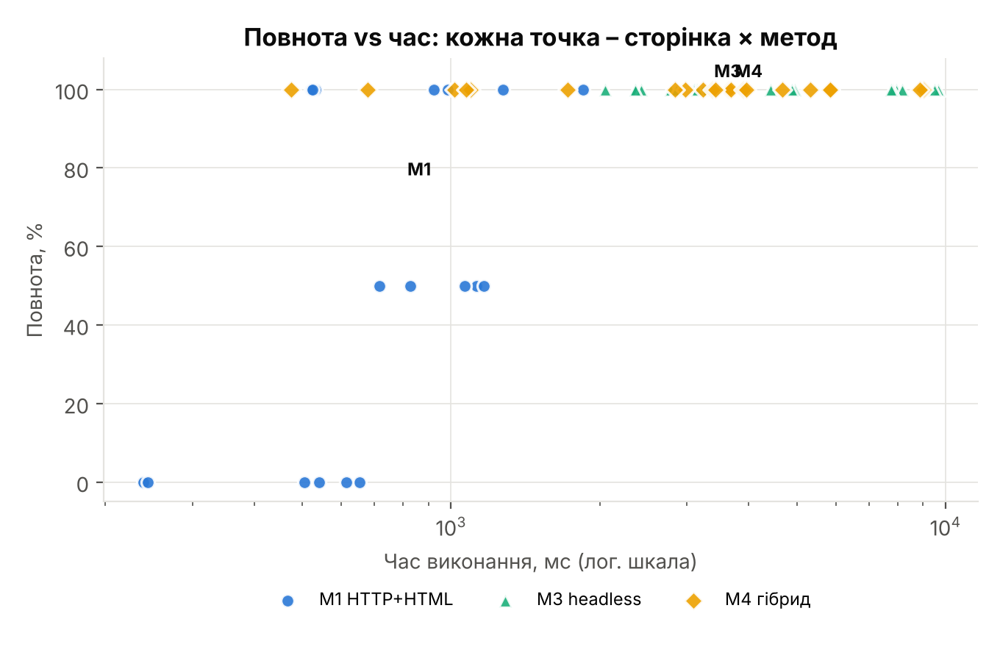

## Гіпотеза 3: стійкість до змін структури (M13)

_блок стійкості не виконано (див. `python -m wsbench stability-run`)_

## 3.7 Кореляційний аналіз (Спірмен)

| Зв'язок | Метод | n | ρ | p | Сила | Напрямок |
|---|---|---|---|---|---|---|
| кількість товарів ↔ час виконання | M1 | 22 | 0.206 | 0,359 | слабкий | прямий |
| кількість товарів ↔ час виконання | M3 | 22 | 0.453 | 0,034 | помірний | прямий |
| кількість товарів ↔ час виконання | M4 | 22 | 0.68 | < 0,001 | сильний | прямий |
| обсяг початкового HTML ↔ повнота М1 | M1 | 22 | 0.414 | 0,055 | помірний | прямий |
| кількість XHR-запитів ↔ час М3 | M3 | 22 | 0.856 | < 0,001 | дуже сильний | прямий |
| кількість запитів ↔ трафік М3 | M3 | 22 | 0.727 | < 0,001 | сильний | прямий |

Пари показників з |ρ| > 0,9 (кандидати на надлишковість):

| Показник 1 | Показник 2 | ρ |
|---|---|---|
| recall | f1 | 1 |
| t_ms | cpu_s | 0.934 |
| traffic_mb | ram_delta_mb | 0.903 |
| traffic_mb | cpu_s | 0.9 |
| ram_delta_mb | cpu_s | 0.937 |

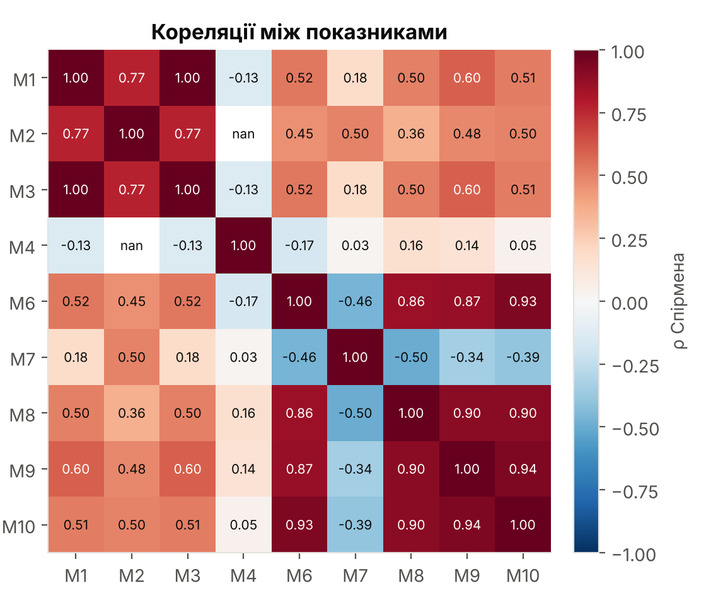

## M14 Трудомісткість підготовки

| method | LOC (медіана) | LOC (середнє) | сторінок |
|---|---|---|---|
| M1 | 3 | 3 | 22 |
| M2 | 4 | 4 | 3 |
| M3 | 3 | 3.136 | 22 |
| M4 | 4 | 4.136 | 22 |

## 3.8 Багатокритеріальне оцінювання

Політика незастосовності: **zero**.

### 3.8.1 Аналіз Парето

Значення показників:

| index | recall | f1 | sr | t_ms | throughput | traffic_mb | ram_delta_mb | cpu_s |
|---|---|---|---|---|---|---|---|---|
| M1 | 75 | 83.335 | 50 | 770.895 | 28.25 | 0.104 | 4.415 | 0.383 |
| M3 | 100 | 100 | 100 | 3 214.705 | 11.516 | 2.613 | 577.26 | 4.25 |
| M4 | 100 | 100 | 98.182 | 3 537.935 | 12.213 | 2.122 | 511.03 | 4.055 |

Не враховано (однакові для всіх методів, не розрізняють їх): precision, field_accuracy

Матриця домінування (рядок домінує над стовпцем):

| index | M1 | M3 | M4 |
|---|---|---|---|
| M1 |  |  |  |
| M3 |  |  |  |
| M4 |  |  |  |

**Множина Парето:** M1, M3, M4

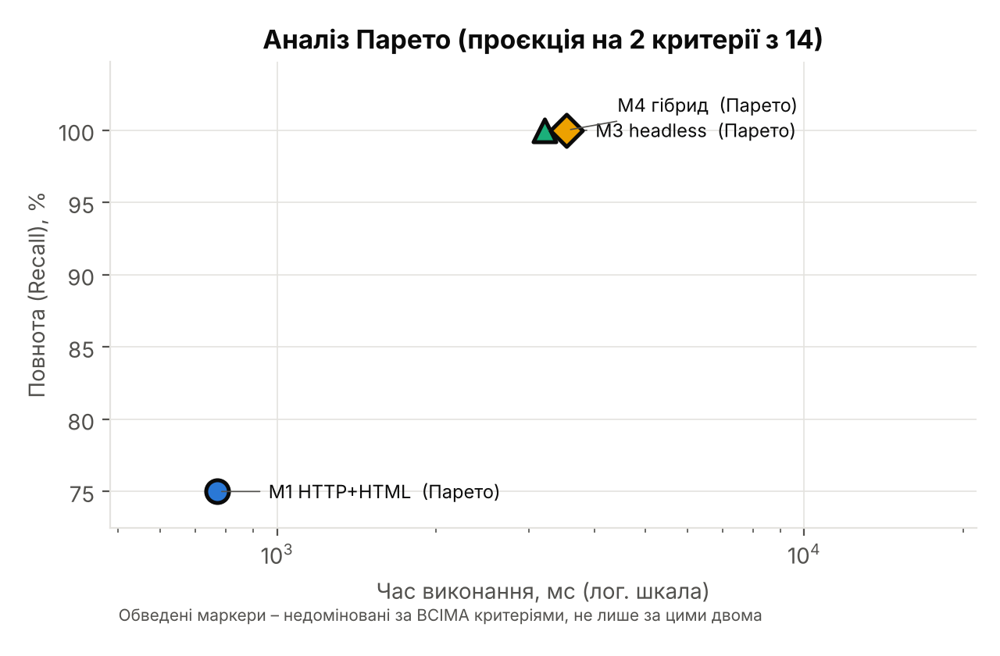

### Ваги AHP (Сааті)

| index | вага |
|---|---|
| K1 | 0.54 |
| K2 | 0.163 |
| K3 | 0.297 |

λmax = 3.0092; CI = 0.0046; CR = 0.0079 → узгоджено (CR < 0,1)

### 3.8.2 Інтегральний показник E (безрозмірний, 0–1)

| index | Рівні ваги | AHP (Сааті) | Повнота понад усе | Масовий моніторинг | Довготривала експлуатація |
|---|---|---|---|---|---|
| M1 | 0.5 | 0.232 | 0.125 | 0.588 | 0.364 |
| M3 | 0.512 | 0.773 | 0.878 | 0.426 | 0.645 |
| M4 | 0.534 | 0.777 | 0.874 | 0.454 | 0.658 |

Ранги:

| index | Рівні ваги | AHP (Сааті) | Повнота понад усе | Масовий моніторинг | Довготривала експлуатація |
|---|---|---|---|---|---|
| M1 | 3 | 3 | 3 | 1 | 3 |
| M3 | 2 | 2 | 1 | 3 | 2 |
| M4 | 1 | 1 | 2 | 2 | 1 |

Ваги сценаріїв (К1 / К2 / К3):

| index | K1 | K2 | K3 |
|---|---|---|---|
| Рівні ваги | 0.333 | 0.333 | 0.333 |
| AHP (Сааті) | 0.54 | 0.163 | 0.297 |
| Повнота понад усе | 0.7 | 0.1 | 0.2 |
| Масовий моніторинг | 0.35 | 0.5 | 0.15 |
| Довготривала експлуатація | 0.35 | 0.2 | 0.45 |

Не входять до згортки: fr, effort_loc, antibot_hits (FR = 100 − SR дублює M5; LOC не виміряний, а заданий).

### Чутливість до складу показників (прибираємо по одному)

| Прибрано | Рівні ваги | AHP (Сааті) | Повнота понад усе | Масовий моніторинг | Довготривала експлуатація |
|---|---|---|---|---|---|
| — (усі показники) | M4 (0.534) | M4 (0.777) | M3 (0.878) | M1 (0.588) | M4 (0.658) |
| M1 Повнота (Recall) | M4 (0.531) | M3 (0.773) | M3 (0.878) | M1 (0.588) | M4 (0.654) |
| M3 F1-міра | M4 (0.531) | M3 (0.773) | M3 (0.878) | M1 (0.588) | M4 (0.654) |
| M5 Частка успішних прогонів (SR) | M4 (0.540) | M4 (0.786) | M4 (0.885) | M1 (0.588) | M4 (0.666) |
| M6 Час виконання | M4 (0.544) | M4 (0.782) | M4 (0.877) | M1 (0.588) | M4 (0.665) |
| M7 Пропускна здатність | M4 (0.539) | M4 (0.779) | M3 (0.879) | M1 (0.588) | M4 (0.662) |
| M8 Мережевий трафік | M4 (0.520) | M3 (0.774) | M3 (0.879) | M1 (0.588) | M4 (0.648) |
| M9 Приріст пам'яті над базою | M4 (0.530) | M4 (0.775) | M3 (0.879) | M1 (0.588) | M4 (0.655) |
| M10 Процесорний час | M4 (0.538) | M4 (0.779) | M3 (0.879) | M1 (0.588) | M4 (0.661) |

### 3.8.3 Аналіз чутливості

Збурення ваг окремих показників ±30 %:

| index | Перемог | Частка перемог, % |
|---|---|---|
| M1 | 0 | 0 |
| M3 | 68 | 6.8 |
| M4 | 932 | 93.2 |

Збурення ваг груп К1–К3 ±30 %:

| index | Перемог | Частка перемог, % |
|---|---|---|
| M1 | 0 | 0 |
| M3 | 91 | 9.1 |
| M4 | 909 | 90.9 |

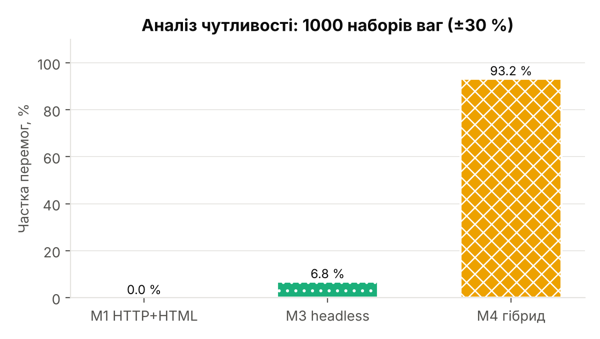

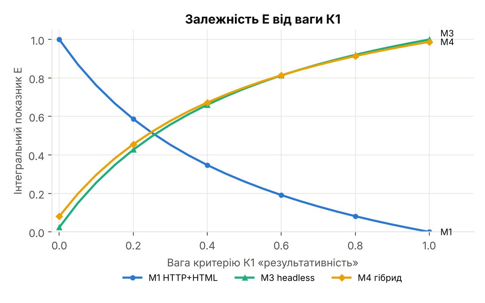
